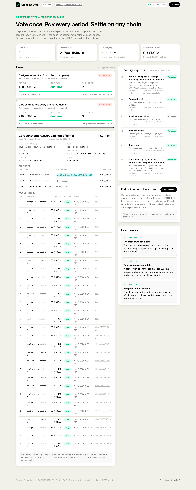

# Standing Order

**Recurring payroll for NEAR treasuries. Vote once, pay every period, settle on any chain.**

A Sputnik DAO funds and authorises a payroll plan in a single vote. From then on the Standing Order
contract pays every contributor on schedule, within the caps the council set, until the council
pauses or cancels it. A keeper that holds a key able to call only `run_due` triggers each period.
Contributors choose where they get paid: on NEAR, or on Base, Arbitrum, Ethereum or Solana through
NEAR Intents, and the contract verifies 1Click's own signature on every cross-chain route before it
pays a deposit address. It plugs into Trezu through custom proposal templates, with no change to Trezu.

Built at NEAR HACKATHON (Nov 2026). Tracks: `social` (Social Money), `realworld` (Real-World Money), `business`.



## The problem

DAO and startup treasuries pay the same people every month, yet on NEAR every payment is a fresh
proposal that humans must file, vote on and sign. Arbitrum's DAO paid nine signers $1,500/month plus
three chairs $2,500/month just to process payments, and wound the service down when the token fell
([forum thread](https://forum.arbitrum.foundation/t/wind-down-the-mss-transfer-payment-responsibilities-to-the-arbitrum-foundation/29279)).
On NEAR, Trezu and NEAR Business offer single and bulk payments and one-off vesting lockups, but no
recurring payment primitive: Trezu's own template docs describe recurring payments as a form members
re-file by hand each cycle, and NEAR's streaming protocol (Roketo) holds about $5K of TVL. Contributors
who want USDC on another chain receive wNEAR and bridge it themselves.

## What Standing Order does

| Before | After |
|---|---|
| 12 payroll proposals a year per contributor group, each needing N signatures | 1 proposal per funding horizon; payday needs no signatures |
| Signer coordination on payday; late or missed pay | Code pays on schedule; missed periods are back-paid or skipped, the council decides |
| Everyone paid on NEAR in one token | Each recipient registers a destination chain/asset; delivery via NEAR Intents |
| Trust the ops person who holds the keys | The keeper key can only call `run_due`; it cannot move funds anywhere but to the plan's recipients |
| Cross-chain routing means trusting a backend | The contract verifies 1Click's ed25519 signature on the quote and binds it to the recipient's registration, exact amount and recipient-owned refund address |

## How it works

```
 Sputnik DAO (council votes once)                     Standing Order contract              Recipients
 ───────────────────────────────                      ───────────────────────              ──────────
 FunctionCall proposal on the token:                  ft_on_transfer → create_plan        dev1.near  (paid on NEAR)
   ft_transfer_call(standing-order, 1200 USDC,  ──►   plan { recipients, interval,        dev2.near  (paid on NEAR)
                    msg = create_plan{...})            cap_per_run, balance }              design.near → registered: USDC on Base
 pause_plan / resume_plan / cancel_plan  ──────►      owner-only management
                                                              ▲
 Keeper (function-call key, run_due only) ────────────────────┘ run_due(plan_id, routes?)
   every 15 s: get_due_plans → for recipients with a destination, fetch a signed 1Click quote →
   contract verifies signature + bindings → pays NEAR accounts directly and routed recipients via the
   1Click deposit address → NEAR Intents delivers USDC on Base; refunds go to the recipient.
```

NEAR tools and why each one is needed:

| Tool | Role |
|---|---|
| **Sputnik DAO** (`sputnik-v2.testnet` factory) | Custody and policy stay with the DAO. One `FunctionCall` proposal funds a plan; pause/resume/cancel are proposals too. |
| **Trezu custom proposal templates** | Six manifests turn those proposals into forms inside Trezu; validated and compiled with Trezu's own engine (`trezu-templates/`). |
| **Function-call access keys** | The keeper account holds a key restricted to `standing-order.testnet::run_due`. The keeper refuses to start with anything broader. |
| **NEAR Intents 1Click API** | Cross-chain delivery. Quotes are signed by 1Click; the contract re-derives the signed message (`base58(sha256(stable_json))`) and checks it with `env::ed25519_verify`. |
| **Named accounts** | Recipients and treasuries are human-readable; no address-poisoning vector on the NEAR leg. |
| **NEP-141 / NEP-297** | Token funding through `ft_transfer_call`; every state change emits a standard event. |

## Try it ("do X, see Y")

### A. Run the full test suite locally (no network, no funds, ~3 minutes)

Requires Rust 1.86+ with the `wasm32-unknown-unknown` target and a C compiler.

```bash
git clone <this repo> && cd standing-order
./scripts/test.sh
```

See: `test result: ok. 29 passed` (unit tests, including verification of a **real signed 1Click quote** against
1Click's production key), then three sandbox suites: `native_plans` 5 passed, `ft_plans` 3 passed,
`routed_payouts` 1 passed. The sandbox tests deploy the contract to a local NEAR node, create and fund
plans through `ft_transfer_call`, pay recipients, re-credit failed transfers, refuse five forged or
mismatched cross-chain quotes and pay the genuine one.

### B. Watch the live testnet deployment (no keys needed)

```bash
npm install
npm run status
```

See: the contract `standing-order.testnet`, DAO `payroll-demo.sputnik-v2.testnet`, each plan with its
next run time, balance and recent payouts, and the recipients' USDC.e balances rising over time.
`npm run watch` keeps printing new payouts as the keeper pays them (plan #1 pays every 2 minutes,
plan #3 every 10 minutes).

```bash
cd web && npm install && npm run dev      # then open http://localhost:3000
```

See: the dashboard with active plans, countdown to the next payday, payout history with explorer
links, the DAO's Standing Order proposals (including the one filed via a Trezu template), and a
"Get paid on another chain" panel. Connect a NEAR testnet wallet to register a destination.

### C. Run the whole loop with your own testnet account (~10 minutes, ~25 testnet NEAR)

```bash
npx near-cli-rs account create-account sponsor-by-faucet-service <you>.testnet autogenerate-new-keypair save-to-legacy-keychain network-config testnet create
# repeat for two more accounts and move their NEAR to <you>.testnet, or use the faucet at near-faucet.io
export SO_MASTER=<you>.testnet SO_CONTRACT=<you>.testnet SO_DAO_NAME=<unique-dao-name> \
       SO_COUNCIL=c1.<you>.testnet,c2.<you>.testnet SO_RECIPIENTS=a.<you>.testnet,b.<you>.testnet,c.<you>.testnet SO_KEEPER=keeper.<you>.testnet
./scripts/demo-full-loop.sh
```

See, step by step: sub-accounts created → contract deployed and initialised → DAO created with a
2-of-2 council → test USDC.e minted to the DAO → proposal #0 filed → both council members vote →
`Plan #1 ... [Active] balance 1200 USDC.e` → `run_due(1) {"Sent":{"sent":3,...}}` → recipients'
balances show 100 / 80 / 60 USDC.e → `pause_plan` proposal approved → `run_due` returns `"Paused"`.

### D. Cross-chain route (mainnet only)

1Click has no testnet, so routed payouts need a mainnet deployment; the sandbox test
`routed_payouts` exercises the full verification path with a stand-in signing key, and the unit test
`real_live_quote_verifies` checks a genuine 1Click signature. The keeper runs in `CROSSCHAIN=dry`
mode on testnet: it still fetches quotes and logs `route unavailable, paying on NEAR` when 1Click
rejects the testnet token. See `docs/TESTNET.md` for the exact commands and `docs/MAINNET.md` for the mainnet runbook.

## Repository layout

| Path | What |
|---|---|
| `contract/` | Rust contract (`near-sdk` 5.30): plans, schedule, payouts, routes, migration. `src/routes.rs` has the 1Click signature verification. Tests in `src/tests.rs`, `src/routes.rs`, `tests/*.rs`. |
| `contract/test-contracts/test-token` | Minimal NEP-141 token used only by sandbox tests. |
| `keeper/` | TypeScript keeper: `run_due`-only key, split-run continuation, 1Click quoting, swap tracking, status endpoint. |
| `scripts/` | Testnet operations: accounts, deploy (+ `--migrate`), DAO creation, token setup, proposals, votes, keeper key, status/watch. |
| `trezu-templates/` | Trezu manifests per network, generator, and a checker that runs Trezu's real validator/engine and can file the compiled proposal. |
| `web/` | Dashboard (Vite + React) in NEAR's brand system; Playwright smoke test. |
| `docs/` | `PLAN.md` (phases and exit tests), `TESTNET.md` (live accounts and transactions), `DEMO.md` (video and post), `SECURITY.md` (threat model). |

## Contract API (short)

| Method | Who | What |
|---|---|---|
| `create_plan(plan)` payable | anyone (owner = caller) | Native-NEAR plans; deposit covers storage, remainder funds the plan. |
| `ft_on_transfer(sender, amount, msg)` | token contract | `{"action":"create_plan","plan":{…}}` or `{"action":"fund_plan","plan_id":N}`; storage from credits or sponsorship. |
| `run_due(plan_id, routes?)` | anyone | Pays the next due period (or continues a split run). `routes` carry signed 1Click quotes for opted-in recipients. |
| `pause_plan`, `resume_plan(plan_id, skip_missed?)`, `update_plan`, `cancel_plan`, `sweep` | plan owner (the DAO) | Governance of a plan. |
| `register_destination(asset_id, address)` / `clear_destination()` | recipient | Where cross-chain payouts land. |
| `get_plans`, `get_plan`, `get_due_plans`, `get_underfunded_plans`, `get_payouts`, `get_route`, `get_destination`, `get_plan_destinations`, `get_config` | view | Everything the dashboard and keeper read. |

Rules enforced on-chain: a run never pays partially; `sum(recipients) ≤ cap_per_run`; `balance` is
debited when a transfer is dispatched and re-credited if the transfer fails; the schedule stays aligned
(`next_run_at += interval`), so missed periods are back-paid one per call unless the council resumes with
`skip_missed`; a route is accepted only if its 1Click signature verifies **and** origin asset = plan token,
amount = recipient's payout, destination asset/address = the recipient's own registration, `refundTo` =
the recipient's NEAR account, and the deposit address is live for at least another minute.

## Threat model and limits

See `docs/SECURITY.md`. In short: the DAO can always pause, sweep or cancel; the keeper can only make
a due payment happen (at most one polling interval early); a compromised keeper cannot redirect
funds because routes must carry 1Click's signature over the recipient's registered address; the
1Click key is owner-rotatable; and the remaining trust is in 1Click executing the swap it signed,
with refunds flowing to the recipient, not to the keeper or the contract.

## What was built during the hackathon, and what was reused

Everything in this repository was written during the hackathon window (first commit 2026-11-08).
Reused: `near-sdk` 5.30 and `near-contract-standards` (test token), `near-workspaces`,
`near-api-js` 7.4, `@defuse-protocol/one-click-sdk-typescript` (keeper-side quote verification),
`@hot-labs/near-connect`, React/Vite, `@fontsource` fonts. Trezu's template engine is **not**
vendored: `trezu-templates/fetch-trezu.sh` clones NEAR-DevHub/trezu so our checker can run Trezu's
own validator. Patterns studied: Trezu's `bulk-payment` contract (gas-metered batching) and the
Sputnik DAO contract (proposal kinds and gas limits).

## License

MIT (see `LICENSE`).
